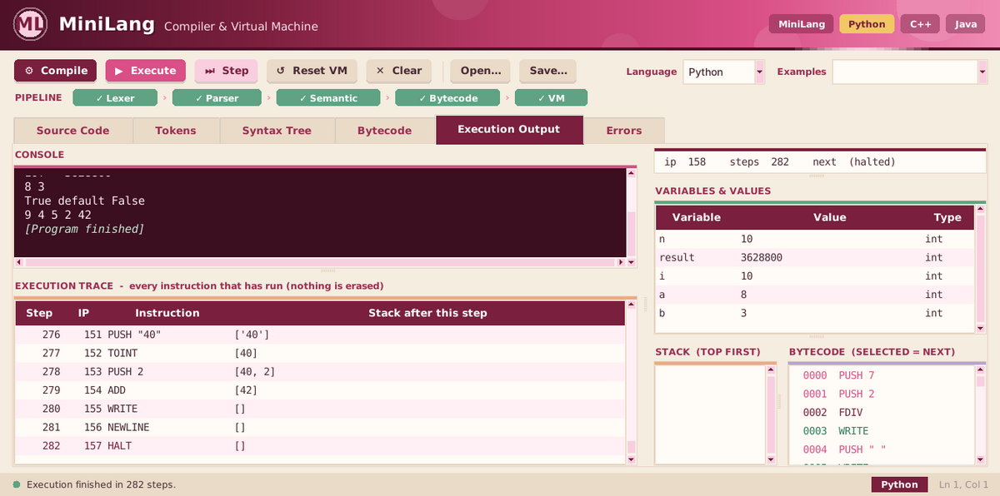
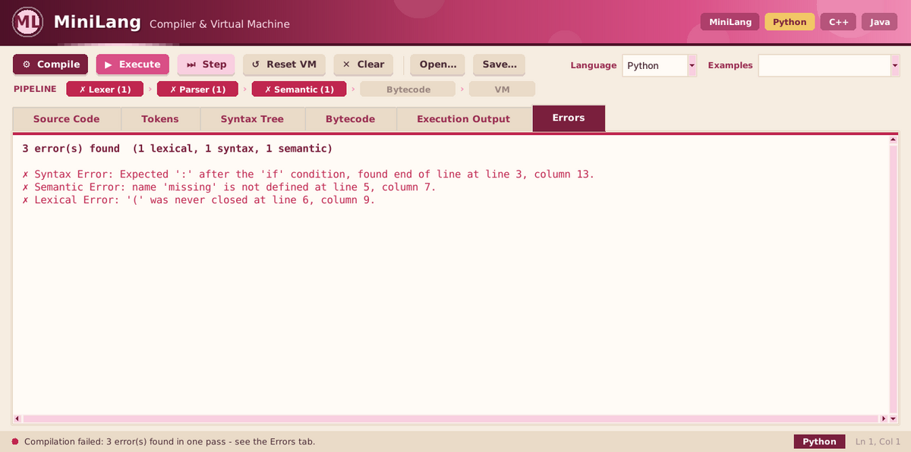
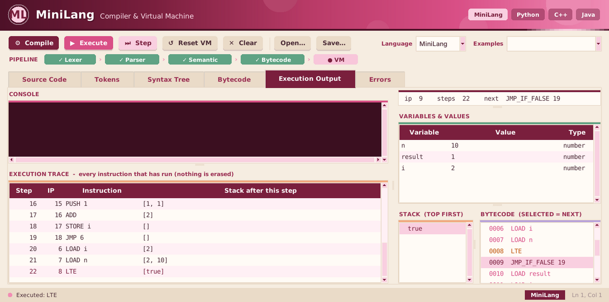
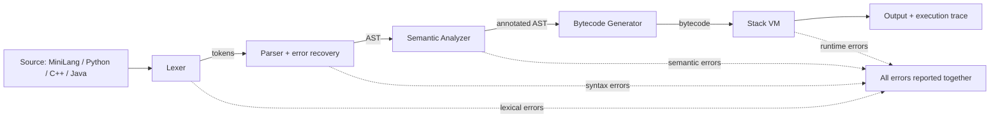

# MiniLang – Multi-Language Compiler & Stack-Based Virtual Machine

A complete compiler-construction project in **pure Python** (no parser generators, no
third-party packages). Programs written in **MiniLang**, a **Python subset**, a **C++ subset**
or a **Java subset** go through language-specific front ends and are translated into **one shared
bytecode** that a hand-written **stack VM** executes – with a full desktop GUI for inspecting every
stage of the compilation.



## Features
* **Four source languages** → one pipeline: `Lexer → Parser → AST → Semantic Analyzer → Bytecode → VM`
* **Behaves like a real compiler:** the whole program is analysed first and **all lexical, syntax and
  semantic errors are reported together** (panic-mode error recovery), with line and column numbers.
  No bytecode is produced – and nothing runs – unless there are zero errors.
* **Custom stack-based VM** with its own stack, memory, instruction pointer and fetch-decode-execute engine.
* **Step-by-step execution:** a persistent *Execution Trace*, a live **Variables & Values** table
  (name · value · type, changed variables highlighted), the stack, and the bytecode with a pointer to the next instruction.
* **Desktop GUI** (Tkinter, baby-pink / burgundy / beige theme): syntax highlighting, colour-coded tokens /
  syntax tree / bytecode, animated pipeline status, toast messages. Adapts to small (1366×768) screens.
* **101 automated tests** + a GUI smoke test, run by GitHub Actions on Windows and Linux.

| Errors found all at once | Step-by-step execution |
|---|---|
|  |  |

## Quick start
Requires **Python 3.8+** (Tkinter ships with the Windows/macOS installers from python.org;
on Debian/Ubuntu: `sudo apt install python3-tk`). Nothing else to install.

```bash
git clone https://github.com/<your-username>/<repo-name>.git
cd <repo-name>
python main.py                           # open the GUI
```

Command line (language is detected from the file extension):
```bash
python main.py examples/python/loops.py
python main.py examples/java/Hello.java --tokens --ast --bytecode
python main.py examples/cpp/error_multiple.cpp      # shows every error at once
python main.py prog.txt --lang python               # choose the language explicitly
```
GUI shortcuts: **F5** Compile · **F6** Execute · **F7** Step one VM instruction.

**No Python?** Download `MiniLang-windows.zip` from the repository's **Releases** page, unzip and run `MiniLang.exe`.

Run the tests: `python -m unittest discover -s tests -v`

## Languages
| | MiniLang | Python subset | C++ subset | Java subset |
|---|---|---|---|---|
| Program | statements | statements (indentation) | `int main(){…}` (optional) | `class X { main }` (optional) |
| Variables | `let x = 1;` | `x = 1` (dynamic) | `int double bool string auto` | `int double boolean String var` |
| Output | `print(x);` | `print(x, sep=, end=)`, f-strings | `cout << x << endl;` | `System.out.println(x)` |
| `7 / 2` | 3.5 | 3.5 (`//` floors) | 3 | 3 |
| Type errors | compile time | run time (like Python) | compile time | compile time |

Shared: `if / else`, `while`, `break`, `continue`, `+ - * / %`, comparisons, logical operators.
C++/Java also: `for`, `++ -- += …`, `return`. Python also: `elif`, `for … in range(…)`, `a, b = b, a`,
`**`, `//`, chained comparisons, `str int float len abs min max round`, string `*`.
Not supported (reported with a clear message): user-defined functions/classes, arrays/lists, `do-while`, input.

<details><summary><b>MiniLang grammar</b></summary>

```
program    := statement* EOF
statement  := letStmt | assignStmt | printStmt | ifStmt | whileStmt | "break" ";" | "continue" ";" | block
letStmt    := "let" IDENT "=" expr ";"          assignStmt := IDENT "=" expr ";"
printStmt  := "print" "(" expr ")" ";"           block      := "{" statement* "}"
ifStmt     := "if" "(" expr ")" block [ "else" ( ifStmt | block ) ]
whileStmt  := "while" "(" expr ")" block
expr       := or ;  or := and ("||" and)* ;  and := equality ("&&" equality)*
equality   := comparison (("==" | "!=") comparison)* ;  comparison := term (("<"|">"|"<="|">=") term)*
term       := factor (("+"|"-") factor)* ;  factor := unary (("*"|"/"|"%") unary)*
unary      := ("-" | "!") unary | primary ;  primary := NUMBER | STRING | "true" | "false" | IDENT | "(" expr ")"
```
</details>

## Architecture


| File | Role |
|---|---|
| `main.py` | entry point – GUI or command line |
| `minilang/languages.py` | language definitions (keywords, operators, samples) |
| `minilang/lexer.py` · `pylexer.py` | lexers (Python's adds NEWLINE / INDENT / DEDENT) |
| `minilang/parser.py` · `cparser.py` · `pyparser.py` | MiniLang / C++ & Java / Python parsers, all with error recovery |
| `minilang/ast_nodes.py` | shared AST + tree printer |
| `minilang/semantic.py` | scopes, types, per-language rules, implicit conversions |
| `minilang/bytecode.py` | AST → instructions (jump back-patching, loops, short-circuit logic) |
| `minilang/vm.py` | stack, memory, IP, execution engine, execution trace |
| `minilang/compiler.py` | pipeline driver (collects every error) |
| `minilang/gui.py` · `widgets.py` | Tkinter UI and the animated theme widgets |
| `examples/` | sample programs per language (incl. an `error_multiple` file for each) |
| `tests/` | 101 unit tests + `gui_smoke.py` |

### Instruction set
`PUSH POP LOAD STORE ADD SUB MUL DIV EQ NEQ GT LT GTE LTE JMP JMP_IF_FALSE PRINT HALT`
(required) plus `NEG NOT MOD IDIV CONCAT TOSTR TOINT TOFLOAT WRITE NEWLINE`
and, for Python, `FDIV FLOORDIV PYMOD POW LEN ABS MIN MAX ROUND FORMAT DUP JMP_IF_TRUE`.

## Building a standalone app
```bash
pip install pyinstaller
pyinstaller --noconfirm --windowed --name MiniLang --add-data "examples;examples" main.py   # use ':' instead of ';' on macOS/Linux
```
Pushing a tag like `v3.1.0` makes GitHub Actions build the Windows `.exe` and attach it to a Release automatically.

## License
MIT – see [LICENSE](LICENSE).
